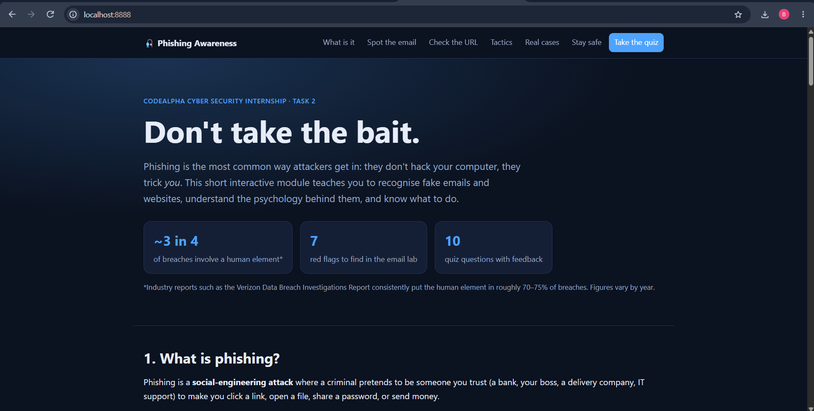
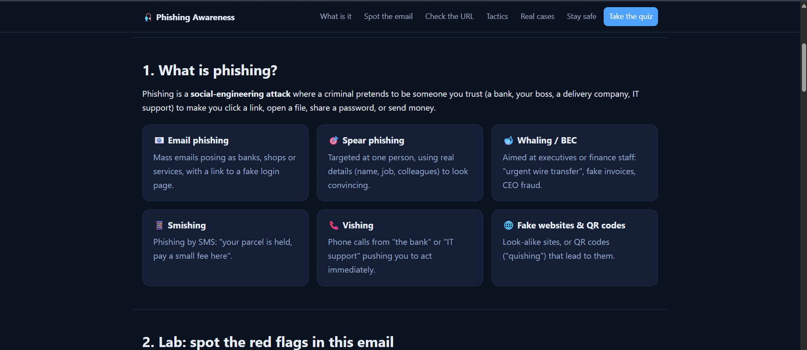
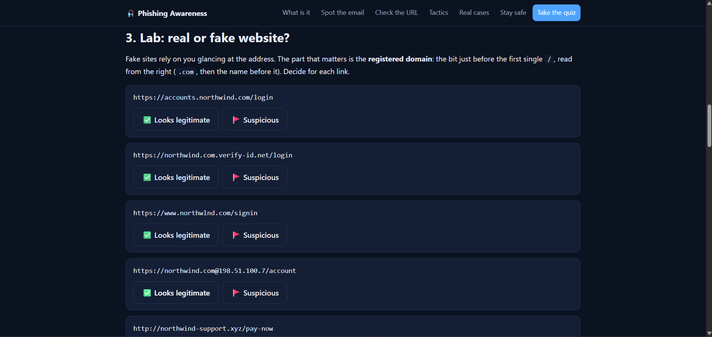
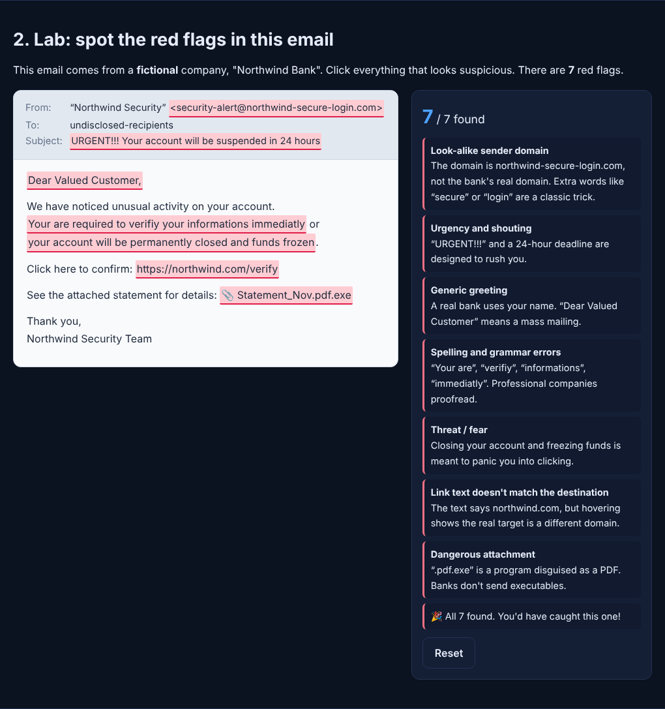
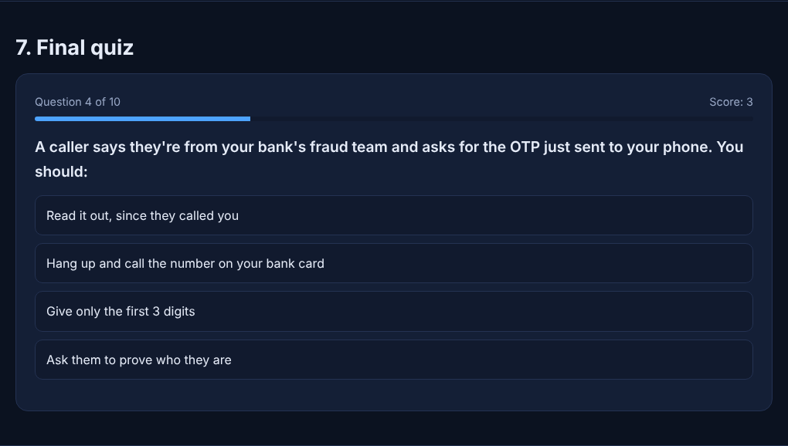
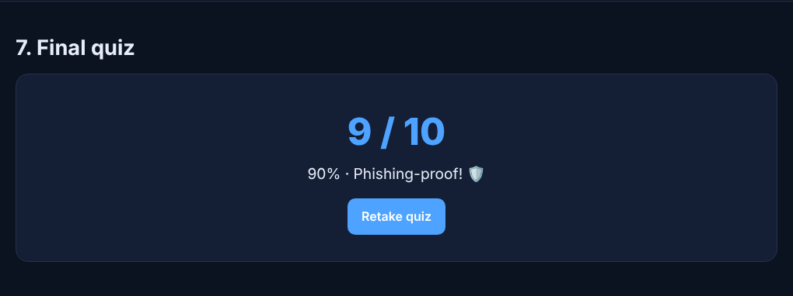

# 🎣 Phishing Awareness Training

**An interactive web module that teaches how to recognise phishing emails and fake websites, understand social engineering, and stay safe, served with Docker on port 8888**

        

---

## 📌 Project Overview

This is my **Task 2 – Phishing Awareness Training** submission for the CodeAlpha Cyber Security Internship.

The project is an **online training module** that runs in the browser. It has short lessons, two hands-on labs and a 10-question quiz. It needs no internet, no database and no login. Everything runs from one small Docker container.

> **Note:** All brands, email addresses and websites in the labs are **fictional** ("Northwind Bank"). No real organisation is imitated and no real credentials are ever collected.

---

## 🎯 Objectives

- Explain what phishing is and its main types.
- Teach how to recognise phishing emails and fake websites.
- Educate about the social-engineering tactics attackers use.
- Provide best practices and tips to avoid falling victim.
- Include real-world examples and interactive quizzes for engagement.

---

## 🚀 Quick Start (Docker, port 8888)

```bash
git clone https://github.com/<your-username>/CodeAlpha_PhishingAwareness.git
cd CodeAlpha_PhishingAwareness
docker compose up -d --build
```

Then open **http://localhost:8888**

Stop it with:

```bash
docker compose down
```

Without Compose:

```bash
docker build -t codealpha-phishing .
docker run -d -p 8888:80 --name codealpha_phishingawareness codealpha-phishing
```

Prefer no Docker? Run `python3 -m http.server 8888 --directory site` and open the same address.

---

## 🧩 What's Inside

| 📚 Section | 🎯 What it teaches |
|---|---|
| 1. What is phishing? | Email, spear phishing, whaling/BEC, smishing, vishing, fake sites and QR codes |
| 2. Email lab | Click the **7 red flags** in a fake bank email |
| 3. URL lab | Decide if 7 links are real or fake (look-alike domains, `@` trick, subdomain trick, short links) |
| 4. Social-engineering tactics | Urgency, authority, fear, greed, curiosity, trust |
| 5. Real-world examples | RSA (2011), fake invoices to Google & Facebook (2013–15), Podesta email (2016), Twitter (2020) |
| 6. Best practices | Do and Don't lists, plus "I already clicked, what now?" |
| 7. Final quiz | 10 questions with instant feedback, explanations and a score |

---

## 🖼️ Screenshots

**Home page** (running at `localhost:8888` in Docker)



**Lesson: what is phishing?**



**Lab: real or fake website?**



**Lab: spot the red flags in the email**



**Quiz question**



**Quiz result**



---

## 🏗️ Project Structure

```
CodeAlpha_PhishingAwareness/
├── site/
│   ├── index.html      # lessons and labs
│   ├── style.css       # styling (light and dark mode)
│   └── app.js          # labs and quiz logic
├── nginx.conf          # web server config with security headers
├── Dockerfile          # nginx:alpine image
├── docker-compose.yml  # maps host port 8888 to container port 80
└── README.md
```

---

# 🔎 Verification

| ✅ Test | 🧾 Action | 🎯 Result |
|---|---|---|
| 📧 Email lab | Click all highlighted parts | Counter reaches 7 / 7 |
| 🌐 URL lab | Answer each link | Correct/incorrect verdict with explanation |
| 📝 Quiz | Answer all 10 questions | Score and grade shown, retake works |
| 📱 Mobile | 390 px wide viewport | No horizontal scrolling |
| 🧱 Strict CSP | Page served with `default-src 'self'` | No console errors |

---

# 🔒 Security Design

- Static files only: no backend, no database, no user data stored.
- Strict **Content-Security-Policy**, `X-Frame-Options: DENY`, `nosniff` and `no-referrer` headers set in `nginx.conf`.
- No external scripts, fonts or trackers; everything loads from the container itself.
- Quiz answers are never sent anywhere.

---

# 💡 What I Learned

### 1. Phishing targets people, not machines
Most attacks succeed because a person is rushed or frightened into acting, not because of a software bug.

### 2. Reading a URL correctly
The real owner of a link is its registered domain, read from the right. Subdomains, `@` tricks and look-alike letters are used to fool the eye.

### 3. Social-engineering levers
Urgency, authority, fear, reward, curiosity and trust appear in nearly every lure.

### 4. Layered defence
MFA, password managers, updates and reporting reduce the damage even when someone clicks.

### 5. Containerising a small project
Packaging the module with Nginx and Docker makes it run the same way on any computer with one command.

---

# 🔐 Security & Ethical Use

This project is for **education and awareness only**. It contains no real phishing pages and collects no data. Never click suspicious links to "test" them, and only run phishing simulations against people who have agreed to take part.

---

# 🔗 Tools & Resources

- **Docker:** https://www.docker.com/
- **Nginx:** https://nginx.org/
- **Anti-Phishing Working Group:** https://apwg.org/
- **CISA – Avoiding social engineering and phishing:** https://www.cisa.gov/

---

# 👤 Author

**Mubassir**
Cyber Security Intern, CodeAlpha

---

## 📌 Project Information

**Program Name:** Cyber Security Internship at CodeAlpha | **Task:** 2 – Phishing Awareness Training | **Repository:** CodeAlpha_PhishingAwareness
